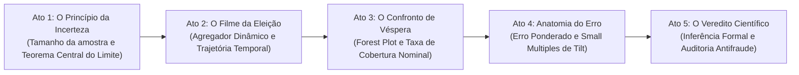

# Jornada de Data Storytelling e Guia da Interface

A interface da aplicação **margem_eleitoral** foi projetada para transformar dados estatísticos complexos e modelos matemáticos de alta densidade em uma experiência fluida, acessível e esclarecedora para o cidadão comum, jornalistas, gestores e especialistas.

Este documento detalha o roteiro narrativo em cinco atos sequenciais, os componentes visuais em Plotly e os recursos interativos de simulação e sincronização em tempo real.

---

## O Roteiro Narrativo em Cinco Atos

A experiência do usuário é guiada por uma estrutura pedagógica em cinco atos sequenciais, concebida para desconstruir gradualmente preconceitos e construir o entendimento científico das pesquisas eleitorais:

---

## Detalhamento dos Atos Narrativos

### Ato 1: O Princípio da Incerteza
* **Objetivo:** Desmistificar o dilema intuitivo de como uma amostra de $\approx 2{.}000$ entrevistados consegue representar fielmente um universo de $156$ milhões de eleitores.
* **Componente Interativo:** *Simulador de Amostragem da Lei dos Grandes Números e Teorema Central do Limite* (`src/presentation/components/simulator.py`).
* **Controles Interativos:**
  * Tamanho da amostra ($n$ de $500$ a $5{.}000$);
  * Intenção real no universo ($p_{\text{real}}$ de $30\%$ a $70\%$);
  * Efeito de delineamento ($deff$ de $1{,}0$ a $2{,}0$);
  * Número de pesquisas simuladas ($200$ a $2{.}000$).
* **Entrega Cognitiva:** O usuário visualiza o histograma das amostras simuladas convergindo perfeitamente para a curva normal em forma de sino, compreendendo por que $95\%$ dos levantamentos caem dentro da margem teórica calculada.

### Ato 2: O Filme da Eleição (Agregador Dinâmico)
* **Objetivo:** Demonstrar que pesquisas capturam momentos voláteis e não o resultado final estático, ensinando a enxergar a trajetória longitudinal e não levantamentos isolados.
* **Componente Interativo:** *Trend Chart do Agregador Dinâmico* (`src/presentation/components/trend_chart.py`).
* **Recursos Visuais:**
  * Linhas contínuas de trajetória por candidato;
  * Fitas de incerteza e envelopes de credibilidade sombreados de $80\%$ e $95\%$;
  * Dispersão pontual de cada pesquisa registrada com opacidade proporcional ao seu peso estatístico ($W_i = w_{\text{tempo}} \times w_{\text{qualidade}} \times \sqrt{n_i}$);
  * Linhas verticais indicando marcos substantivos da campanha (início do horário eleitoral gratuito na TV, debates presidenciais de grande repercussão, etc.).
* **Controles Interativos:**
  * Filtro metodológico (Todas, Presenciais Domiciliares, Telefônicas CATI, Online);
  * Alternância entre *Votos Válidos Recalculados* e *Votos Totais Brutos*.

### Ato 3: A Prova dos Fatos (Pesquisas de Véspera vs. Urna)
* **Objetivo:** Confrontar de forma honesta as últimas estimativas divulgadas pelos institutos com o resultado oficial apurado pelo Tribunal Superior Eleitoral.
* **Critério de Inclusão Científica:** Estritamente pesquisas cujo campo de coleta encerrou a no máximo 72 horas antes da abertura das urnas ($t_{\text{eleição}} - t_{\text{fim\_campo}} \le 3\text{ dias}$).
* **Componente Interativo:** *Forest Plot de Véspera* (`src/presentation/components/forest_plot.py`).
* **Elementos Visuais:**
  * Eixo Y: Nomes dos institutos ordenados por proximidade temporal da eleição;
  * Eixo X: Percentual de votos válidos para o candidato selecionado no dropdown;
  * Barras horizontais de erro: Estimativa pontual $\pm 1{,}96 \times SE_{\text{ajustado}}$ (incorporando o $deff$);
  * Linha vertical sólida contrastante: Apuração oficial da urna no TSE.
* **Métrica Central em Destaque:**
  * **Taxa de Cobertura Empírica:** Percentual de intervalos de confiança que cruzam a linha da apuração oficial frente à meta nominal teórica de $95\%$.

### Ato 4: Anatomia do Erro e Auditoria de Institutos
* **Objetivo:** Fornecer um painel aprofundado de auditoria e responsabilização dos institutos em duas camadas complementares:
  1. *Camada de Impacto Eleitoral:* Erro Ponderado multivariado ($EP = (1-a)D + aF + 0{,}5X$) e calibração estocástica dinâmica via simulação de Monte Carlo.
  2. *Camada de Auditoria Científica:* Métricas consagradas WAPOR/AAPOR ($M_3$, $M_5$, Log-Odds $A$) e taxas de acerto da margem.
* **Componentes Visuais:**
  * **Gráfico de Barras Segmentadas de Erro Ponderado:** Decomposição visual dos erros divididos por faixas (*Abaixo do Típico* vs. *Erro Típico*) com a linha tracejada da *Faixa do Acaso ($P_{90}$)* derivada via Monte Carlo;
  * **Tabela Interativa e Auditável:** Tabela classificatória com busca, ordenação dinâmica por qualquer métrica de erro, data de campo e tamanho de amostra;
  * **Grid de Small Multiples de Inclinação Longitudinal (Tilt):** Matriz de subplots exibindo a inclinação de cada instituto em relação ao consenso de mercado em janelas móveis de $\pm 7$ dias, com intervalo $t$-Student de $80\%$;
  * **Caixa Metodológica Expansível:** Memorial com todas as equações matemáticas exibidas em LaTeX para conferência técnica imediata.

### Ato 5: O Veredito Científico (Diagnóstico do TSE)
* **Objetivo:** Sintetizar o diagnóstico formal de inferência estatística respondendo de forma conclusiva à pergunta: *"Divergências pontuais configuram fraude eleitoral?"*.
* **Bateria de Diagnósticos Automatizados:**
  * Cards interativos com resultados do Teste $t$ de Student pareado, Teste de Wilcoxon e Teste Binomial exato;
  * Tabela de Análise de Variância (ANOVA de Tipo II) para isolar efeitos sistemáticos de institutos (*house effects*) e metodologia;
  * Decomposição formal do Total Survey Error ($MSE = \text{Bias}^2 + \text{Var}_{\text{Amostral}} + \text{Var}_{\text{Late Swing}} + \text{Var}_{\text{Estrutural}}$);
  * Parecer conclusivo fundamentado nos dados sobre abstenção diferencial e volatilidade de última hora.

---

## Sistema de Design Visual e Identidade da Interface

A interface adota a estética de **jornalismo analítico profissional em Dark Mode** (estilo *Plano Político* e *FiveThirtyEight*), desenhada para maximizar legibilidade, contraste e densidade de informação:

* **Paleta de Cores do Tema Dark Mode:**
  * Fundo da aplicação: `#121417` (cinza escuro profundo, reduzindo fadiga visual);
  * Superfície dos cartões e contêineres: `#181B20` com bordas sutis em `#282D37`;
  * Tipografia principal: `#F8FAFC` (branco suave) e `#CBD5E1` (cinza claro);
  * Badges de erro abaixo do típico: `#10B981` (verde esmeralda);
  * Badges de erro típico e alertas: `#F59E0B` (âmbar dourado);
  * Badges de erro acima do típico: `#EF4444` (vermelho carmim);
  * Linha oficial da urna TSE: `#F8FAFC` com halo contrastante.
* **Componentes Responsivos em Plotly:**
  * Todos os gráficos possuem tooltips informativos em formato HTML nativo;
  * Altura calculada dinamicamente conforme a quantidade de institutos auditados;
  * Suporte a zoom sincronizado e download direto da imagem em alta resolução.

---

## Sincronização Contínua e Extensão ao 2º Turno de 2026

Para viabilizar o acompanhamento contínuo da eleição em tempo real, a barra lateral da aplicação integra um módulo de sincronização:

1. **Seletor de Ano e Turno:**
   * Permite alternar instantaneamente entre a auditoria da eleição de **2026** (com foco no 1º e 2º turno) e o benchmark histórico de **2022**.
2. **Formulário de Inserção de Pesquisa em Tempo Real:**
   * Permite cadastrar um novo levantamento de 2º Turno informando número de registro no TSE, nome do instituto, metodologia, tamanho de amostra e percentuais brutos dos concorrentes.
   * O sistema recalcula automaticamente os votos válidos com validação estrita via Pydantic e injeta os dados na sessão, atualizando instantaneamente o agregador e as métricas.
3. **Integração com Dados Abertos do TSE:**
   * Botão de recálculo que dispara a verificação de novos registros no repositório de dados abertos do PesqEle do TSE.
