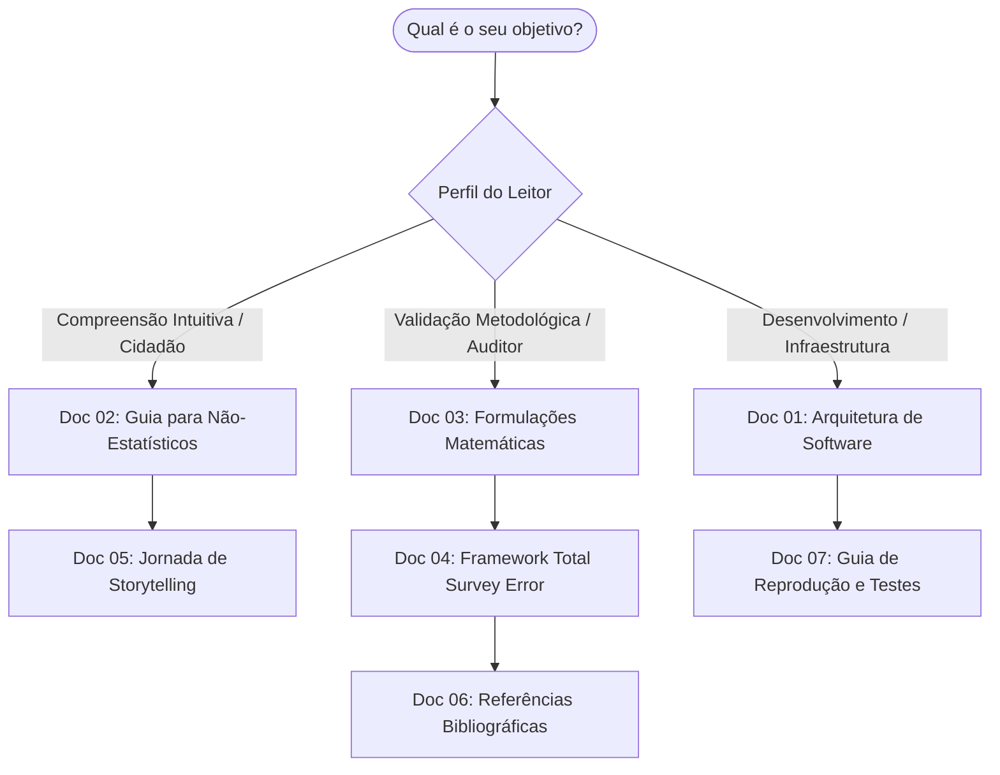

# Sumário Executivo e Índice Geral da Documentação

Bem-vindo à documentação técnica e analítica do projeto **Margem Eleitoral** (*Auditoria e Storytelling Científico de Pesquisas Eleitorais*). 

Este repositório reúne um arcabouço computacional e estatístico sênior desenvolvido em Python para auditar, modelar e interpretar pesquisas eleitorais registradas no Tribunal Superior Eleitoral (TSE). Projetada sob uma arquitetura modular extensível a múltiplos ciclos eleitorais (2018, 2022 e 2026) e múltiplos cargos eletivos (Presidente, Governador e Senador), a solução confronta tecnicamente a crença popular de fraude eleitoral a partir de formulações científicas consagradas mundialmente pela **WAPOR** (*World Association for Public Opinion Research*) e **AAPOR** (*American Association for Public Opinion Research*).

---

## Estrutura da Documentação

A documentação está organizada modularmente em 7 tratados temáticos, permitindo navegação tanto para tomadores de decisão e leitores não-estatísticos quanto para engenheiros de dados e cientistas da computação:

| Documento | Título | Público-Alvo | Conteúdo Principal |
| :--- | :--- | :--- | :--- |
| [**Doc 01**](01_visao_geral_e_arquitetura.md) | **Visão Geral e Arquitetura de Software** | Engenheiros, Arquitetos, Analistas | Princípios de engenharia, arquitetura em camadas desacopladas, pipelines de ETL vetoriais com Polars, contratos estritos com Pydantic v2, blindagem via Gatekeeper e persistência Parquet. |
| [**Doc 02**](02_guia_estatistico_para_nao_estatisticos.md) | **Guia Estatístico para Não-Estatísticos** | Público Geral, Jornalistas, Gestores | Explicações didáticas sem jargões: como 2.000 pessoas representam 156 milhões, por que pesquisa não prevê resultado, o que é voto válido, $deff$ e guia dos gráficos dos 7 atos. |
| [**Doc 03**](03_metodologia_e_formulacoes_estatisticas.md) | **Metodologia e Formulações Matemáticas** | Estatísticos, Cientistas de Dados | Deduções matemáticas exaustivas: Efeito de Delineamento ($deff$ de Kish), Mosteller $M_3$ e $M_5$, Log-Odds $A$, Erro Ponderado ($EP$), Monte Carlo sob $H_0$, Agregador Dinâmico, Rejeição/Teto e Modelo Preditivo Hierárquico. |
| [**Doc 04**](04_framework_tse_total_survey_error.md) | **Framework de Total Survey Error (TSE)** | Pesquisadores, Auditores, Peritos | Modelo de Groves et al. (2004) aplicado ao Brasil: decomposição do erro em amostragem, cobertura, abstenção diferencial, efeito de casa e movimentação de última hora (*late swing*). |
| [**Doc 05**](05_jornada_data_storytelling_e_interface.md) | **Jornada de Storytelling e Interface** | Designers de Produto, Jornalistas de Dados | Detalhamento dos 7 Atos Narrativos da aplicação, componentes visuais em Plotly (Forest Plot, Small Multiples, Dumbbell, Waterfall, Sensibilidade), Hero Story Cards e modais. |
| [**Doc 06**](06_referencias_bibliograficas_e_normas.md) | **Referências Bibliográficas e Normas** | Acadêmicos, Auditores Legais | Normas WAPOR/AAPOR, resoluções do TSE, bibliografia seminal (Mosteller, Kish, Groves, Biemer, Silver, Gelman, Jackman) e manuais de amostragem. |
| [**Doc 07**](07_guia_de_desenvolvimento_e_reproducao.md) | **Guia de Engenharia e Reprodução** | Desenvolvedores, Avaliadores Técnicos | Guia prático de setup com `uv`, execução do Streamlit, CLI `margem`, pipelines de ingestão, execução da suíte de 186 testes automatizados com cobertura de 87% e linter Ruff. |

---

## Mapa de Leitura Recomendado

---

## Links Rápidos para Execução
* **Executar a aplicação interativa:** `uv run app` *(ou `uv run app.py`)*
* **Interface de linha de comando (CLI):** `uv run margem --help`
* **Rodar os 186 testes com cobertura:** `uv run pytest --cov=src --cov-report=term-missing tests/`
* **Verificação de qualidade de código:** `uv run ruff check src/ tests/`
