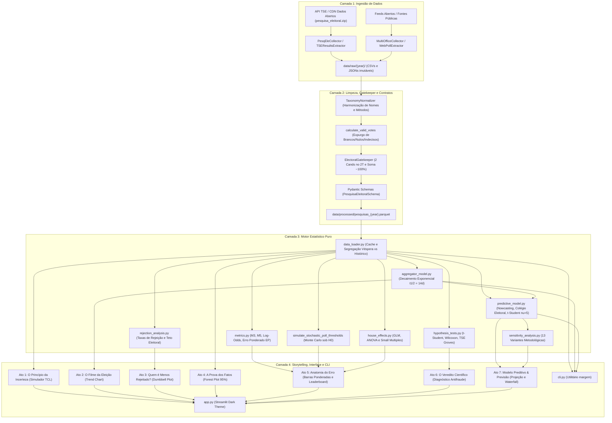

# Visão Geral e Arquitetura de Software

O projeto **Margem Eleitoral** foi concebido sob princípios rigorosos de engenharia de software e ciência de dados moderna, priorizando reprodutibilidade científica, desacoplamento de responsabilidades, alta performance computacional, arquitetura extensível a múltiplos ciclos eleitorais (2018, 2022 e 2026) e múltiplos cargos (Presidente, Governador e Senador), além de integridade de dados.

Este documento detalha as decisões estruturais do repositório, o fluxo de ponta a ponta dos dados e a justificativa técnica para a seleção de cada componente do stack.

---

## Princípios de Design e Arquitetura

A base de código segue quatro diretrizes arquiteturais invioláveis:

1. **Separação Estrita de Responsabilidades (SoC):**
   * O motor de cálculo analítico e inferencial (`src/analytics/`) é puramente numérico e determinístico, sem qualquer importação ou dependência de bibliotecas gráficas ou de interface (como Streamlit ou Plotly). Isso possibilita que os algoritmos sejam testados em isolamento absoluto ou reaproveitados em pipelines de backend/batch e terminal CLI.
2. **Design Orientado a Contratos Estritos (Contract-First via Pydantic v2 & Gatekeeper):**
   * Nenhuma observação bruta de pesquisa ou resultado apurado transita entre camadas sem validação formal de tipos, limites de intervalo ($0 \le p \le 100$), consistência cronológica e conformidade constitucional no 2º Turno (estritamente 2 candidatos e fechamento em ~100% via `ElectoralGatekeeper`).
3. **Processamento Colunar Vetorial de Alta Performance (Polars & Apache Parquet):**
   * Manipulações de dados em larga escala (séries temporais diárias do agregador, cenários de simulação Monte Carlo e consolidação de registros históricos) utilizam Polars em formato colunar com serialização imutável em Parquet.
4. **Idempotência e Cache de Ingestão:**
   * O pipeline de ingestão preserva snapshots brutos imutáveis em disco (`data/raw/{ano}/`), evitando requisições redundantes às APIs do TSE e permitindo auditoria forense retrospectiva.

---

## Estrutura Modular do Repositório

O repositório está organizado na seguinte topologia modular:

```
margem_eleitoral/
├── config/
│   ├── settings.yaml            # Parâmetros de corte temporal, thresholds, pesos do Colégio Eleitoral
│   └── taxonomy_mapping.yaml    # Harmonização de institutos, métodos e candidatos
├── data/
│   ├── raw/                     # Snapshots brutos imutáveis por ano (2018, 2022, 2026)
│   └── processed/               # Datasets limpos e tipados em Parquet e JSON
├── docs/                        # Tratados detalhados de documentação técnica (Docs 00 a 07)
├── src/
│   ├── analytics/               # Computação científica pura e inferência estatística
│   │   ├── aggregator_model.py  # Agregador contínuo temporal com decaimento exponencial
│   │   ├── house_effects.py     # GLM, ANOVA de 2 fatores e tilt longitudinal
│   │   ├── hypothesis_tests.py  # Testes de Wilcoxon, t-Student, Binomial e TSE
│   │   ├── metrics.py           # Mosteller M3/M5, Log-Odds, Erro Ponderado e Monte Carlo
│   │   ├── predictive_model.py  # Modelo estado-espaço hierárquico, calibração e Monte Carlo
│   │   ├── rejection_analysis.py # Modelagem de taxas de rejeição e teto eleitoral
│   │   └── sensitivity_analysis.py # Avaliação das 13 variantes metodológicas
│   ├── ingestion/               # Coletores de dados e orquestração de ETL
│   │   ├── base.py              # Classe base abstrata para extração eleitoral
│   │   ├── data_loader.py       # Carregador de alta performance com cache de sessão
│   │   ├── multi_office_collector.py # Coletor multi-ano e multi-cargo (Pres, Gov, Sen)
│   │   ├── pesqele_collector.py # Ingestão e censo dos registros do PesqEle
│   │   ├── pipeline.py          # Pipeline consolidado de transformação e persistência
│   │   ├── tse_results.py       # Extração da totalização oficial do TSE
│   │   └── web_poll_extractor.py # Ingestão e validação de pesquisas web abertas
│   ├── presentation/            # Camada visual e orquestração do storytelling
│   │   ├── app.py               # Ponto de entrada Streamlit (tema dark analítico)
│   │   ├── components/          # Visualizações Plotly, modais e cards executivos
│   │   └── story_acts/          # Telas narrativas completas (Atos 1 a 7)
│   ├── transformations/         # Validação de esquemas e normalização de entidades
│   │   ├── gatekeeper.py        # Blindagem constitucional de integridade eleitoral
│   │   ├── normalizer.py        # Harmonização taxonômica e fonética
│   │   ├── schemas.py           # Contratos de dados Pydantic v2
│   │   └── valid_votes.py       # Algoritmo de conversão canônica para votos válidos
│   └── cli.py                   # Interface de linha de comando com 6 subcomandos
├── tests/                       # Suíte de 186 testes com 87% de cobertura (pytest)
├── app.py                       # Wrapper de execução raiz do Streamlit
├── get.py                       # Utilitário de raspagem multi-cargo
├── pyproject.toml               # Configuração de build, dependências uv, scripts e linter ruff
└── README.md                    # Apresentação executiva do repositório
```

---

## Diagrama de Fluxo de Dados e Camadas

O diagrama abaixo ilustra o ciclo de vida dos dados desde a ingestão nos servidores do Tribunal Superior Eleitoral e feeds públicos até a renderização nos 7 Atos interativos e na CLI:



---

## Justificativa da Escolha do Stack Tecnológico

| Tecnologia | Função no Projeto | Critério Técnico e Racional da Escolha |
| :--- | :--- | :--- |
| **Python 3.12+** | Runtime de Execução | Benefícios de tipagem avançada (`typing.Self`, union types `|`), otimizações no interpretador e suporte às versões mais recentes das bibliotecas científicas. |
| **Astral uv** | Gerenciador de Pacotes e Ambiente | Velocidade de resolução até 10x superior ao pip/poetry, determinismo estrito via `uv.lock` e capacidade de execução isolada com `uv run`. |
| **Polars** | Motor de Manipulação Tabular | Avaliação preguiçosa (*lazy execution*), implementação em Rust com multi-threading nativo, sem overhead do GIL e IO de arquivos Parquet ultrarrápido. |
| **Pydantic v2** | Validação de Contratos | Validação em nível de compilação em C/Rust (pydantic-core), garantindo que dados defeituosos do PesqEle não corrompam os cálculos matemáticos. |
| **SciPy & NumPy** | Computação Numérica e Distribuições | Precisão numérica para testes de postos sinalizados (Wilcoxon), teste $t$, distribuição $t$-Student multivariada com caudas pesadas ($\nu=5$) e sorteios multinomiais de Monte Carlo. |
| **Statsmodels** | Modelagem Estatística Formal | Ajuste formal de modelos lineares (OLS/GLM) e tabelas ANOVA de Tipo II para decomposição de efeitos de instituto e metodologia. |
| **Plotly** | Visualização Interativa de Dados | Gráficos vetoriais interativos com tooltips detalhados, sincronização de zoom, Dumbbell Plot, Forest Plot e renderização dark mode responsiva. |
| **Streamlit** | Interface e Plataforma de Storytelling | Prototipagem ágil e reativa com retenção de estado de sessão, formulários de entrada para sincronização de novas pesquisas e transições fluidas entre os 7 Atos. |
| **Pytest & Pytest-Cov** | Garantia de Qualidade | Arquitetura de testes baseada em funções e fixtures nativas (sem `unittest`), atingindo **87% de cobertura global** sobre 4.780 statements. |
| **Ruff** | Linter e Formatador | Execução instantânea de conformidade com PEP 8, ordenação determinística de imports e detecção precoce de código morto. |

---

## Contratos de Dados (Pydantic Schemas)

A integridade do pipeline é mantida por contratos fundamentais em `src/transformations/schemas.py`:

### Contrato de Pesquisa Eleitoral (`PesquisaEleitoralSchema`)

```python
class PesquisaEleitoralSchema(BaseModel):
    id_registro_tse: str = Field(..., pattern=r"^[A-Z]{2}-\d{5}/\d{4}$")
    instituto_razao_social: str
    instituto_nome_fantasia: str
    data_inicio_campo: date
    data_fim_campo: date
    data_divulgacao: date
    tamanho_amostra: int = Field(..., gt=0)
    margem_erro_declarada: float = Field(..., gt=0.0, le=10.0)
    nivel_confianca: float = Field(default=0.95, gt=0.8, lt=1.0)
    metodologia: MetodologiaEnum
    deff_estimado: float = Field(default=1.3, ge=1.0, le=3.0)
    votos_totais: dict[str, float]
    votos_validos: dict[str, float]
    percentual_indecisos: float = Field(..., ge=0.0, le=100.0)
    percentual_brancos_nulos: float = Field(..., ge=0.0, le=100.0)
    rejeicao: dict[str, float] | None = Field(default=None)
    turno: int = Field(default=1, ge=1, le=2)
    cargo: str = Field(default="PRESIDENTE")
    ano: int = Field(default=2026)
    abrangencia: AbrangenciaEnum = Field(default=AbrangenciaEnum.NACIONAL)
    uf: str = Field(default="BR", min_length=2, max_length=5)
    regiao: str = Field(default="BR", min_length=1, max_length=5)
    tier_fonte: TierFonteEnum = Field(default=TierFonteEnum.TIER_2_CONTRATANTE_ORIGINAL)
    url_fonte_publicacao: str | None = None
    url_tse_pesqele: str | None = None
    verificado_tse: bool = True

    @model_validator(mode="after")
    def validate_chronology(self) -> Self:
        if self.data_fim_campo < self.data_inicio_campo:
            raise ValueError("Data final não pode anteceder a data inicial.")
        if self.data_divulgacao < self.data_fim_campo:
            raise ValueError("Data de divulgação não pode anteceder o fim do campo.")
        return self

    @model_validator(mode="after")
    def validate_gatekeeper(self) -> Self:
        if self.turno == 2:
            ElectoralGatekeeper.validate_second_round_candidate_count(
                turno=self.turno, candidates_with_votes=self.votos_totais, poll_id=self.id_registro_tse
            )
            ElectoralGatekeeper.validate_poll_sum(
                votos_totais=self.votos_totais,
                percentual_brancos_nulos=self.percentual_brancos_nulos,
                percentual_indecisos=self.percentual_indecisos,
                poll_id=self.id_registro_tse,
                turno=self.turno,
            )
        return self
```

### Contrato de Resultado Oficial do TSE (`ResultadoOficialTSESchema`)

```python
class ResultadoOficialTSESchema(BaseModel):
    cargo: str = "PRESIDENTE"
    turno: int = Field(..., ge=1, le=2)
    ano: int = 2026
    total_votos_validos: int = Field(..., ge=0)
    total_brancos: int = Field(..., ge=0)
    total_nulos: int = Field(..., ge=0)
    total_abstencoes: int = Field(..., ge=0)
    resultado_nominal: dict[str, float]
    apuracao_concluida: bool = True

    @model_validator(mode="after")
    def validate_percentages(self) -> Self:
        if not self.apuracao_concluida:
            return self
        soma = sum(self.resultado_nominal.values())
        if not (99.8 <= soma <= 100.2):
            raise ValueError(f"Soma dos percentuais nominais deve convergir para 100%, obtido {soma:.2f}%.")
        return self
```

### Contrato de Rejeição de Candidatos (`RejeicaoPesquisaSchema`)

```python
class RejeicaoPesquisaSchema(BaseModel):
    instituto: str
    data_inicio_campo: date
    data_fim_campo: date
    data_divulgacao: date
    rejeicao_nominal: dict[str, float]
    turno: int = Field(default=1, ge=1, le=2)
    ano: int = Field(default=2026)
    tamanho_amostra: int | None = Field(default=None, gt=0)
    margem_erro: float | None = Field(default=None, gt=0.0)
    observacao: str | None = None
    onda_anterior: bool = False
```

---

## Estrutura de Caching e Otimização de Performance

A aplicação opera em tempo real e oferece carregamento instantâneo por meio de uma estratégia de cache de dois níveis:

1. **Camada de Disco (Parquet e JSON em `data/processed/`):**
   * As pesquisas normalizadas e recalculadas em votos válidos são armazenadas em formato Parquet comprimido com Snappy, permitindo leitura colunar seletiva.
   * Os metadados oficiais do TSE residem em arquivos JSON estruturados.
2. **Camada de Sessão da Aplicação (`data_loader.py`):**
   * O carregamento de dados em memória utiliza dicionários em cache baseados na tupla `(ano, turno, cargo, uf)`.
   * Pesquisas registradas adicionadas pelo usuário durante o 2º Turno são injetadas dinamicamente na sessão do Streamlit (`st.session_state`), disparando o recálculo do modelo em frações de segundo sem necessidade de reprocessar o arquivo original em disco.
